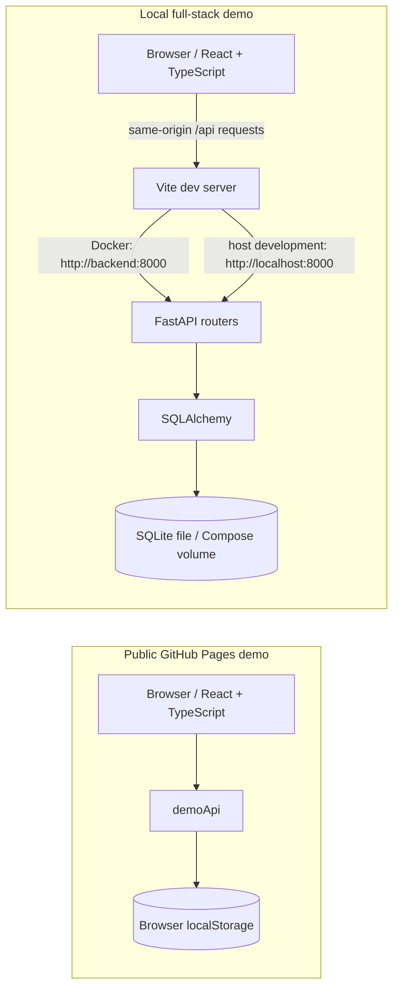

# CloudPulse Architecture

CloudPulse has two frontend data modes. The public GitHub Pages portfolio uses browser-local sample data. Local development can use the FastAPI API and SQLite. Both modes currently simulate checks; neither sends requests to the endpoint URLs being displayed.

## Runtime and data flow

### Public demo mode

`VITE_DEMO_MODE=true` selects `frontend/src/services/demoApi.ts` instead of the Axios/FastAPI client. It seeds illustrative endpoints, results, and incidents, then saves visitor changes under the `cloudpulse-demo-v1` localStorage key. If browser storage is unavailable, the demo falls back to in-memory state for the page session. No configured endpoint URL is contacted.

### Local API mode

`frontend/src/services/api.ts` uses Axios. When `VITE_API_URL` is blank (the local default), requests use the same origin under `/api`. Vite proxies those requests to `http://localhost:8000` for host-based development; Docker Compose overrides the proxy target to `http://backend:8000`, the Compose service name. The browser itself never needs to resolve the Docker-only hostname. Set `VITE_API_URL` to an explicit API origin only when the frontend and API are intentionally hosted separately.

FastAPI routes in `backend/app/api/` validate request/response data with Pydantic schemas and obtain request-scoped SQLAlchemy sessions through `get_db`. `GET /health` runs `SELECT 1` against the configured database before reporting ready. `init_db()` registers all models and creates missing tables; it is not a migration system.

## Implemented behavior and boundaries

- Endpoint CRUD, search, status filtering, activation toggling, incident acknowledgement/resolution, and history/statistics views are implemented.
- Disabled endpoints cannot be manually checked through the UI or API. The result-history API validates pagination bounds, and forced outcomes accept only `success` or `failure`.
- Check outcomes and response times are simulated. The local backend uses an 80% success probability; the browser demo uses an 88% probability. Both values are demo behavior, not monitoring measurements.
- Statistics are calculated on demand from saved simulated results. There is no polling, WebSocket/SSE stream, or scheduled worker; `check_interval` is stored configuration only.
- `Alert` is a database model and relationship only. There is currently no alert API or alert-configuration UI.
- Authentication and user/tenant ownership enforcement are not implemented. Do not expose the backend to untrusted networks or store sensitive data.

## Persistence and testing

- Local API mode defaults to `sqlite:///./cloudpulse.db`.
- Compose sets `sqlite:///./data/cloudpulse.db` and mounts the `cloudpulse_data` named volume at `/app/data`.
- Backend API tests use a separate in-memory SQLite engine with `StaticPool`, recreate the schema around each test, and override FastAPI's `get_db` dependency. They do not intentionally use the developer's configured database.
- The CI schema-initialization step uses a dedicated ignored `.ci-cloudpulse.db` path. CI's Docker smoke test separately starts the Compose stack and checks backend health, the frontend, and the Vite-to-backend API proxy.

## Deployment boundary

The free-tier public deployment is a static React build on GitHub Pages. It runs in browser-local demo mode and does not deploy or expose FastAPI, SQLite, or a public backend. In GitHub Actions, the Pages build/deploy jobs wait for the backend tests, dependency audits, frontend tests/lint/build, and Docker Compose smoke check to pass.

See [README.md](README.md) for local commands and [DEPLOYMENT.md](DEPLOYMENT.md) for the current Pages setup and verification status.
